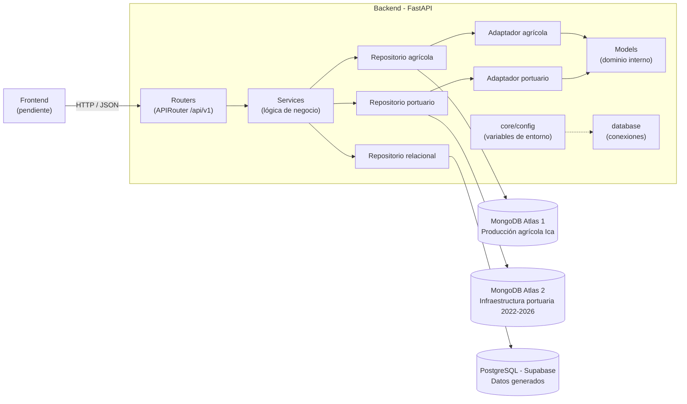

# Arquitectura de AgroPort Ica

Este documento describe la arquitectura del backend y cómo se integrarán las tres
bases de datos. Las secciones marcadas como **futuro** describen el diseño previsto.
Esas partes no se han implementado todavía.

## 1. Visión general



## 2. Responsabilidad de cada base de datos

| Base de datos | Tipo | Responsabilidad | Uso por el backend |
|---|---|---|---|
| MongoDB Atlas 1 | NoSQL (documentos) | Dataset de lugares de producción agrícola de la región Ica | Solo lectura (fuente externa) |
| MongoDB Atlas 2 | NoSQL (documentos) | Dataset de infraestructura portuaria del Perú, periodo 2022-2026 | Solo lectura (fuente externa) |
| PostgreSQL (Supabase) | SQL (relacional) | Información generada por el sistema: evaluaciones, estimaciones, recomendaciones | Lectura y escritura |

Otros integrantes del equipo despliegan y administran las tres bases de datos.
El backend no crea colecciones ni importa datasets. Tampoco define el esquema de
las fuentes MongoDB, sino que se adapta a los esquemas reales que reciba.

## 3. Capas del backend y separación de responsabilidades

| Capa | Carpeta | Responsabilidad | Prohibido |
|---|---|---|---|
| Configuración | `core/` | Leer variables de entorno y exponer `Settings` | Lógica de negocio |
| Routers | `routers/` | Definir endpoints HTTP, validar la entrada y serializar la salida | Acceder directamente a la BD |
| Schemas | `schemas/` | Definir los contratos Pydantic de la API (request/response) | Lógica de negocio |
| Services | `services/` | Contener la lógica de negocio y orquestar los repositorios | Depender de drivers concretos |
| Repositories | `repositories/` | Ejecutar consultas y persistencia por fuente de datos | Reglas de negocio |
| Adapters | `adapters/` | Traducir documentos externos a modelos internos | Acceso a red / BD |
| Models | `models/` | Definir entidades del dominio independientes de la BD | Detalles de almacenamiento |
| Database | `database/` | Crear y cerrar conexiones (clientes Mongo y engine SQL) | Consultas de negocio |

El flujo de dependencias es unidireccional:
`routers → services → repositories → (adapters) → database`.

## 4. Capa de negocio (services)

Los servicios implementarán las funcionalidades del sistema (**futuro**):

- Consulta integrada de información agrícola y portuaria.
- Evaluación de certificaciones.
- Estimación de la producción.
- Generación de recomendaciones logísticas preliminares.

Los servicios trabajan solo con modelos de dominio. No saben si un dato proviene
de MongoDB o de PostgreSQL. Así se pueden probar con repositorios sustitutos y se
aíslan de los cambios de esquema.

## 5. Patrón adaptador (esquemas externos)

Los datasets de MongoDB tienen esquemas que define otro equipo y que pueden cambiar:
nombres de campos, tipos o anidamiento. Por eso no se deben usar tal cual dentro de
la lógica de negocio.

Cada fuente tendrá un **adaptador** que convierte el documento crudo en un modelo de
dominio interno:

```text
documento MongoDB (esquema externo)  →  Adaptador  →  Modelo de dominio (esquema interno)
```

- Si cambia un nombre de campo en el dataset, solo se modifica el adaptador.
- Los adaptadores son funciones puras, sin acceso a red, y fáciles de probar.
- **Pendiente:** se implementarán cuando se conozcan los esquemas reales. No se
  inventarán campos.

## 6. Patrón repositorio (acceso a datos)

Cada fuente tendrá un repositorio que encapsula cómo se consulta o persiste la
información:

- `RepositorioAgricola`: consultas a MongoDB Atlas 1 (lectura).
- `RepositorioPortuario`: consultas a MongoDB Atlas 2 (lectura).
- Repositorios relacionales: lectura y escritura en PostgreSQL (Supabase).

Los servicios dependen de los repositorios y no de PyMongo ni de SQLAlchemy. Los
nombres anteriores son **orientativos**. Se definirán junto con los esquemas reales.

## 7. Integración futura entre SQL y NoSQL

1. Los datos de origen (producción agrícola e infraestructura portuaria) se leen
   desde MongoDB a través de repositorios y adaptadores.
2. Los servicios combinan ambas fuentes en memoria, usando claves comunes que se
   acordarán con el equipo (por ejemplo, ubicación o región).
3. Los resultados generados por el sistema, como evaluaciones, estimaciones y
   recomendaciones, se guardan en PostgreSQL. Así se tiene integridad referencial
   y un historial consultable.
4. No existe una transacción distribuida entre motores. Las fuentes MongoDB se
   tratan como de solo lectura y la única escritura ocurre en PostgreSQL.

## 8. Configuración y tolerancia a fallos

- Toda la configuración de conexión se lee de variables de entorno (ver
  `.env.example`). Nunca se versionan credenciales.
- La aplicación debe iniciar aunque las variables estén vacías. Las conexiones se
  establecerán de forma diferida y cada integración informará su propio estado.
- El endpoint `/api/v1/health` solo indica que la aplicación está en ejecución.
  Un futuro chequeo de conectividad por base de datos será un endpoint separado y
  reportará estados reales, no simulados.

## 9. Estado

| Elemento | Estado |
|---|---|
| Estructura de capas | Creada (Fase 1) |
| Configuración por entorno | Implementada |
| Endpoints `/` y `/api/v1/health` | Implementados |
| Conexiones a BD | Pendientes |
| Adaptadores / repositorios / modelos | Pendientes de esquemas reales |
| Lógica de negocio | Pendiente |
